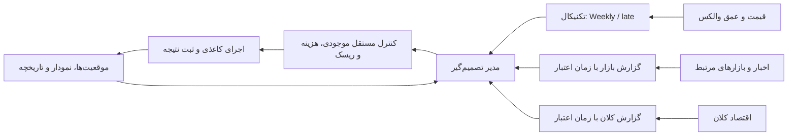

# اتاق تصمیم | Wallex Trade Bot

سامانهٔ پژوهشی معاملهٔ اسپات که پیش‌بینی تکنیکال را با تحلیل خبر، اقتصاد کلان و کنترل مستقل ریسک ترکیب می‌کند. مدل آموزش‌دیدهٔ **Barrier Survival — Weekly / late** همراه همین مخزن ارائه شده است؛ برای اجرای آن به آموزش دوباره نیاز ندارید.

**وضعیت:** دمو و معاملهٔ کاغذی قابل اجرا هستند. اتصال اجرای واقعی آماده‌سازی شده، اما غیرفعال است. این مخزن تضمین سودآوری یا سامانهٔ تأییدشده برای اجرای بدون نظارت نیست.

## شروع سریع

### ۱. نصب و اجرای مدل همراه مخزن

Python 3.11 پیشنهاد می‌شود. از ریشهٔ مخزن:

```powershell
git clone https://github.com/AliNajafpour/trade-bot.git
cd trade-bot
python -m venv .venv
.\.venv\Scripts\python.exe -m pip install -r requirements.txt
.\.venv\Scripts\python.exe run.py verify
```

در Linux و macOS به‌جای مسیر ویندوز از `.venv/bin/python` استفاده کنید.

`verify` هر سه فایل وزن را با SHA-256 بررسی می‌کند، مدل را روی CPU بارگذاری می‌کند و یک پیش‌بینی عددی واقعی روی ورودی تشخیصیِ مصنوعی می‌گیرد. این بررسی آفلاین است؛ نه سفارش می‌فرستد و نه نتیجهٔ معاملاتی تولید می‌کند. GPU برای inference لازم نیست.

### ۲. اجرای کاغذی با دادهٔ بازار

```powershell
Copy-Item .env.example .env
# روش دسترسی مدل زبانی را در .env تنظیم کنید.
.\.venv\Scripts\python.exe run.py paper
```

داشبورد: **http://127.0.0.1:8850/**

این دستور جمع‌کنندهٔ قیمت و گزارش‌ها را همراه موتور Weekly / late اجرا می‌کند. سرمایهٔ نمونه ۱۰۰ تتر مجازی است. دادهٔ عمومی والکس به کلید خصوصی نیاز ندارد. مدیر زبانی به یکی از این دو روش نیاز دارد:

- نصب و ورود معتبر به Codex CLI، با `LLM_PROVIDER=codex`؛
- API سازگار، با `LLM_PROVIDER=openai_compatible` و متغیرهای `LLM_API_KEY`، `LLM_BASE_URL` و `LLM_MODEL`.

این گفت‌وگو جای سرویس LLM در رایانهٔ دریافت‌کننده را نمی‌گیرد. نبود سرویس یا کلید، خطا ثبت می‌کند؛ پاسخ ساختگی جایگزین نمی‌شود.

در اولین اجرا، تاریخچهٔ لازم دریافت می‌شود و آماده‌شدن پیش‌بینی می‌تواند زمان ببرد. `Ctrl+C` اجرا را متوقف می‌کند؛ تا وقتی برنامه خاموش است، حفاظت کاغذی TP/SL هم اجرا نمی‌شود. [راهنمای کامل نصب و تنظیمات](docs/setup.md)

## معماری تصمیم



قیمت و گزارش‌ها زمان‌بندی مستقل دارند. تنظیم نمونه، قیمت هر ۱۰ ثانیه، گزارش بازار هر ۳۰ دقیقه و گزارش کلان روزانه است. هر منبع، زمان دریافت و محدودیت پوشش خود را حفظ می‌کند.

## مدل همراه مخزن

| مشخصه | مقدار |
|---|---|
| خانواده | Barrier Survival Multiday |
| نسخهٔ فعال | Weekly / late |
| ورودی | ۱۰٬۰۸۰ کندل کامل یک‌دقیقه‌ای؛ یک هفته |
| دارایی‌ها | BTC، ETH، SOL، S با مبنای USDT |
| معماری | کانولوشن، توجه سلسله‌مراتبی و پرسش TP/SL با cross-attention |
| ترکیب مدل | سه آموزش مستقل + کالیبراسیون دما |
| خروجی | احتمال TP زودتر، SL زودتر، بدون برخورد |
| وزن‌های همراه | سه فایل نهایی، مجموعاً حدود ۴٫۷ مگابایت |

مدل احتمال لمس قیمت را تخمین می‌زند؛ لمس قیمت به معنی تضمین پُرشدن سفارش نیست. افق احتمال نیز زمان خروج اجباری نیست. [جزئیات مدل و بازآموزی](docs/models.md)

## تنظیم جاری معامله

| مورد | تنظیم |
|---|---|
| بازار | خرید اسپات؛ بدون فروش استقراضی و لوریج |
| هدف سود / حد ضرر | ۲٪ / ۲٪ |
| افق احتمال | ۲۴ ساعت |
| شرط تکنیکال ورود | احتمال مطلق TP پیش از SL بیشتر از ۵۵٪ |
| مدیر | تأیید ورود، انتظار، نگهداری یا خروج زودتر |
| خروج زمانی | ندارد |
| حجم | تحت محدودیت نقدینگی، هزینه و ریسک |

در نسخهٔ فعلی، مدیر TP/SL را دلخواه جابه‌جا نمی‌کند. مسیرهای مدل‌های آمادهٔ Kronos و Chronos-2 و بانک ده استراتژی برای توسعه و مقایسه نگه‌داری شده‌اند؛ آن‌ها هم‌زمان ورودی تکنیکال این آزمایش نیستند و وزن‌های حجیمشان همراه مخزن نیست.

## نتیجهٔ تاریخی ثبت‌شده

در بازهٔ مشترک **۲۸ سپتامبر تا ۱۲ اکتبر ۲۰۲۶**، تنظیم بالا ۱۷ معاملهٔ بسته داشت: ۱۲ برد و ۵ باخت، با یک موقعیت باز در پایان. بازده خالص با ارزش‌گذاری موقعیت باز **۱٫۳۴۳٪+** و حداکثر افت سرمایه **۰٫۸۴۴٪** بود.

این نتیجه فقط مربوط به لایهٔ تکنیکال است. کارمزد هر سمت ۱۳ واحد پایه و اصطکاک **فرضی** هر سمت ۵ واحد پایه لحاظ شده است. ترکیب پس از مشاهدهٔ نتایج تاریخی انتخاب شده؛ دفتر سفارش تاریخی وجود نداشته و این عدد، تأیید اجرای واقعی یا سود ترکیب کامل خبر و تکنیکال نیست. [روش ارزیابی و محدودیت‌ها](docs/results.md) · [خلاصهٔ عددی](docs/results-summary.json)

## ساختار مخزن

```text
run.py                         بارگذاری مدل و اجرای کاغذی
wallex_lab/                    مدل، داده، ایجنت‌ها، ریسک و اجرا
  survival_news.py             Weekly / late همراه خبر و کلان
  barrier_survival.py          معماری و inference مدل اصلی
  graph_agents.py              گردش متخصص‌ها با LangGraph
  intelligence_reports.py      گزارش‌های دارای زمان اعتبار
  spot.py                     حساب و اجرای کاغذی
  live_execution.py            درگاه واقعی؛ خاموش در تنظیم همراه
models/barrier-survival/late/   فقط وزن‌های نهاییِ مدل فعال
config/                       تنظیمات نمونه؛ بدون کلید و حساب واقعی
scripts/                      ابزارهای اصلی دریافت داده، آموزش و ارزیابی
checks/                       بررسی فعلی مرز اجرای سفارش
video-demo/                   دمو و نمودارهای آفلاین
docs/                         مستندات فنی
third_party/                  منبع لازمِ وابستگی Kronos و مجوز آن
```

دادهٔ حجیم، checkpointهای میانی، محیط مجازی، حساب‌ها، کلیدها، گزارش‌های خصوصی و خروجی آزمایش‌های قدیمی از انتشار حذف شده‌اند. فقط سه وزن نهاییِ مورد نیاز برای اجرای مدل فعال داخل Git قرار گرفته‌اند.

## مستندات فنی

- [نصب، اجرا و پیکربندی](docs/setup.md)
- [معماری و قراردادهای اجزا](docs/architecture.md)
- [مدل، ورودی، خروجی و آموزش](docs/models.md)
- [منابع داده و جلوگیری از نشت آینده](docs/data.md)
- [ارزیابی، سود و محدودیت نتیجه](docs/results.md)
- [مرز اجرای واقعی و نگه‌داری کلیدها](docs/execution.md)
- [وابستگی‌های شخص ثالث](docs/third-party.md)

## اجرای واقعی و اطلاعات حساس

اجرای کاغذی به اجرای واقعی وصل نشده است. `config/live-execution.json` با `enabled=false`، اتصال حساب خالی و استاپ تأییدنشده منتشر می‌شود. فرمان پیش‌فرض این ماژول فقط بررسی خواندنی انجام می‌دهد. راه‌انداز `run.py` هم فقط کاغذی است.

کلید را در `.env` یا محیط فرایند بگذارید؛ فایل `.env`، موجودی، دفتر حساب و پاسخ‌های خصوصی را commit نکنید. کلید واقعی برای استفاده از دمو و اجرای مدل عددی لازم نیست. [جزئیات اجرای واقعی](docs/execution.md)
