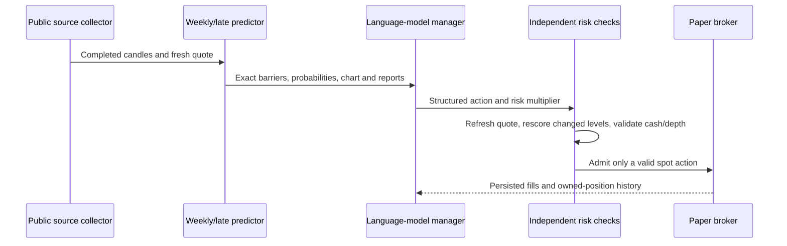

# Architecture and boundaries

The main experiment is a cash-funded, long-only spot paper account. A negative view can retain cash or reduce an owned position; it does not create a short or leveraged trade.

## Data plane

`run.py source` collects public Wallex bid/ask books independently per symbol and publishes `runtime-state.json`. Report workers collect public market/news and macro evidence separately, then use `ReportStore` to generate validated reports. Each report records generation and expiry times, source IDs, coverage, confidence and risk multiplier.

`survival_news.Runner` reads the feed and reports, maintains its own coherent history cache and uses `SurvivalPredictor` for technical inference. Reference history, executable Wallex quotes and model outputs remain distinct objects. A receipt timestamp is not presented as the exchange's matching-engine event time.

## Main decision path

The language model does not receive permission to override numerical checks. It evaluates `enter/wait/reject` for a flat asset or `hold/close` for an owned position. For the fixed-barrier experiment, TP and SL stay at their original levels. A scheduled review retains its prior reasoning rather than reappearing as an unrelated new request.

## Schedules

Default public quotes refresh every ten seconds, market/news reports every 1,800 seconds, and macro reports every 86,400 seconds. Technical scans operate on completed decision boundaries. Slow collection and LLM work run outside the protective account loop; an already running worker is not duplicated merely because another tick arrives.

Reports can be reused only while valid. Missing evidence is unknown, not neutral evidence. Missing fresh execution prices cannot be waived by a confident narrative. An unresolved probability path is not a winning trade or an assumed zero return.

## LangGraph and adapters

`graph_agents.py` prepares an analysis request, dispatches regime/sentiment/fundamentals specialists and joins their outputs into a decision. SQLite checkpoints and content-addressed receipts support replay and recovery. `market_council.py` contains the broader stateful manager workflow and optional coherent-management, adaptive-weight and strategy-bank paths.

The current Weekly/late experiment reuses the report store, provider boundary, charts and paper broker. It is a separate runner, not an assertion that every historical comparison account runs the same LangGraph topology. `providers.py` selects authenticated Codex CLI or an explicitly configured compatible API without changing the risk/execution boundary.

## Persistence and execution

| Component | Stored state |
|---|---|
| Source collector | Quotes, original freshness metadata, worker errors |
| Report store | Evidence bundle, report, availability, validity and receipt hashes |
| Weekly runner | Scans, model identity, manager reviews, experiment deadline |
| Paper broker | Virtual cash, owned positions and idempotent simulated fills |
| Graph workflows | SQLite checkpoints and structured decision history |
| Real gateway | Separate account-bound SQLite order-intent ledger |

OS locks prevent concurrent account writers. JSON replacement is atomic; the real gateway persists submission state before a possible exchange mutation. The real-order transport remains separate from paper fills: an acknowledged exchange order is not a completed fill.

The five-minute HTML fixture has its own synthetic generator and no connection to these production loops. See [execution](execution.md) for unverified real-order behavior.
